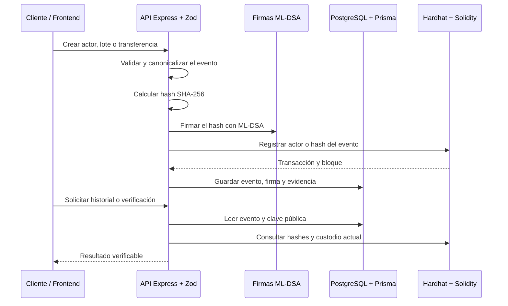

# Trazabilidad Farmacéutica Blockchain

<div align="center">

**Prototipo académico para registrar, transferir y verificar la custodia de lotes farmacéuticos.**


</div>

## Sobre el proyecto

Este proyecto implementa un sistema de trazabilidad farmacéutica que permite registrar lotes ficticios y seguir su recorrido entre distintos actores de la cadena de suministro.

Cada evento se convierte en un documento JSON canónico, se protege mediante **SHA-256** y se firma fuera de la cadena con **ML-DSA**, un esquema de firma digital poscuántica estandarizado en FIPS 204. La blockchain local conserva las evidencias mínimas necesarias: actores, custodios y hashes verificables.

> [!WARNING]
> Este proyecto es un prototipo académico. Utiliza datos, cuentas y claves de desarrollo ficticias. No debe utilizarse con información farmacéutica real ni como sistema de producción.

## ¿Qué permite hacer?

- Registrar actores con dirección blockchain, rol y clave pública ML-DSA.
- Crear lotes farmacéuticos con metadatos y un fabricante responsable.
- Transferir la custodia del lote entre actores autorizados.
- Consultar el historial completo de eventos.
- Verificar hashes, firmas, claves públicas y continuidad de la cadena de custodia.
- Comparar la información almacenada fuera de la cadena con las evidencias fijadas en blockchain.
- Medir el costo de gas y el rendimiento de las operaciones criptográficas.
- Explorar el flujo completo desde una interfaz web en español.

## Arquitectura



### Separación de responsabilidades

| Capa | Responsabilidad |
| --- | --- |
| Frontend React + Vite | Recorrido guiado, actores, lotes, custodia, historial y verificación |
| API Express + Zod | Validación, reglas de negocio y endpoints HTTP |
| PostgreSQL + Prisma | Almacenamiento de eventos completos, firmas y metadatos |
| Solidity + Hardhat | Registro de actores, lotes, custodios y hashes |
| ML-DSA | Firmas digitales poscuánticas en la capa de aplicación |

La información completa y las firmas permanecen fuera de la cadena. El contrato almacena únicamente referencias y hashes, reduciendo costos y evitando guardar datos extensos en el EVM.

## Tecnologías

- **Backend:** Node.js, TypeScript, Express, Zod y Swagger.
- **Frontend:** React, Vite y TypeScript.
- **Blockchain:** Solidity, Hardhat y ethers.
- **Persistencia:** PostgreSQL y Prisma.
- **Criptografía:** SHA-256, canonicalización JSON y ML-DSA-44/65/87.
- **Calidad:** ESLint, Prettier, Vitest y pruebas de contratos.

## Requisitos

- Node.js **24.x** y npm **12.x**.
- Docker y Docker Compose.
- Git.

Las versiones exactas están fijadas en `package.json` y `package-lock.json`.

## Instalación y ejecución

### 1. Instalar dependencias

```bash
npm ci
cp .env.example .env
```

### 2. Iniciar PostgreSQL

```bash
docker compose up -d
npm run prisma:generate
npm run prisma:migrate -- --name init
```

Si el puerto `5432` está ocupado:

```bash
POSTGRES_PORT=55432 docker compose up -d
```

En ese caso, actualiza el puerto de `DATABASE_URL` en `.env`.

### 3. Iniciar la blockchain local

En una terminal:

```bash
npx hardhat node
```

En otra terminal, despliega el contrato:

```bash
npx hardhat run --network localhost scripts/deploy-local.ts
```

Guarda la dirección del contrato en `REGISTRY_CONTRACT_ADDRESS` dentro de `.env`. También configura una o varias claves de las cuentas ficticias de Hardhat mediante `CHAIN_PRIVATE_KEY` o `CHAIN_PRIVATE_KEYS_JSON`.

> Nunca subas `.env`, claves privadas ni la carpeta `keys/` al repositorio.

### 4. Iniciar el backend

```bash
npm run dev
```

La API estará disponible en `http://localhost:3000`.

- Documentación Swagger: `http://localhost:3000/docs`
- Estado del servicio: `http://localhost:3000/health`

### 5. Iniciar el frontend

En otra terminal:

```bash
cd frontend
npm ci
npm run dev
```

Abre `http://localhost:5173` para utilizar la interfaz gráfica.

## Flujo de demostración

1. Registrar los actores ficticios de la cadena de suministro.
2. Crear un lote farmacéutico.
3. Transferir la custodia a otro actor autorizado.
4. Consultar el historial y separar la evidencia on-chain de la información off-chain.
5. Ejecutar la verificación de autenticidad.
6. Revisar hashes, firmas ML-DSA, claves públicas, transacciones y bloques.

Para una presentación de 3 a 5 minutos, consulta el [guion de demostración](docs/demo-script.md).

## API principal

| Método | Endpoint | Descripción |
| --- | --- | --- |
| `POST` | `/actors` | Registra un actor y su clave pública |
| `POST` | `/lots` | Crea un lote farmacéutico |
| `POST` | `/lots/:id/transfer` | Transfiere la custodia del lote |
| `GET` | `/lots/:id` | Consulta el lote y sus eventos |
| `GET` | `/lots/:id/history` | Obtiene el historial off-chain |
| `GET` | `/lots/:id/verify` | Verifica hashes, firmas y continuidad |
| `GET` | `/health` | Comprueba el estado de la API |

La documentación interactiva está disponible en Swagger cuando el backend está ejecutándose.

## Pruebas y calidad

```bash
npm run build
npm run lint
npm run compile
npm run test:contract
npm run test:unit
npm test
```

Para generar mediciones locales:

```bash
npm run measure:gas
npm run measure:crypto
npm run measure:confirmation
```

Los resultados se guardan en `reports/`. El informe consolidado está en [`reports/measurements.md`](reports/measurements.md).

## Estructura del repositorio

```text
├── contracts/       Contratos Solidity
├── docs/             Arquitectura, decisiones y guion de demostración
├── frontend/         Interfaz React + Vite
├── prisma/           Esquema y migraciones PostgreSQL
├── reports/          Mediciones reproducibles
├── scripts/          Despliegue, sincronización y benchmarks
├── src/              API, dominio, blockchain y criptografía
├── test/             Pruebas unitarias y de contratos
└── types/            Tipos generados para los contratos
```

## Limitaciones conocidas

- La blockchain utilizada es local y las cuentas son de desarrollo.
- ML-DSA se utiliza en la capa de aplicación; las transacciones EVM continúan utilizando ECDSA/secp256k1.
- El contrato no verifica firmas ML-DSA dentro de Solidity.
- No incluye HSM, rotación o recuperación de claves, revocación ni control de acceso multiusuario.
- PostgreSQL y la blockchain no forman una transacción distribuida automática.
- Las mediciones dependen del equipo, el sistema operativo, la versión de Node.js y la carga del proceso.

Consulta la lista completa en [docs/limitations.md](docs/limitations.md).

## Documentación adicional

- [Arquitectura](docs/architecture.md)
- [Trazabilidad de requisitos](docs/traceability.md)
- [Decisiones técnicas](docs/decisions/)
- [Guion de demostración](docs/demo-script.md)
- [Limitaciones](docs/limitations.md)

## Contexto académico

El proyecto fue desarrollado como un prototipo reproducible para explorar la combinación de blockchain, trazabilidad farmacéutica y firmas digitales poscuánticas. Su objetivo es facilitar la experimentación, la demostración técnica y la evaluación de costos y verificabilidad de los eventos.
