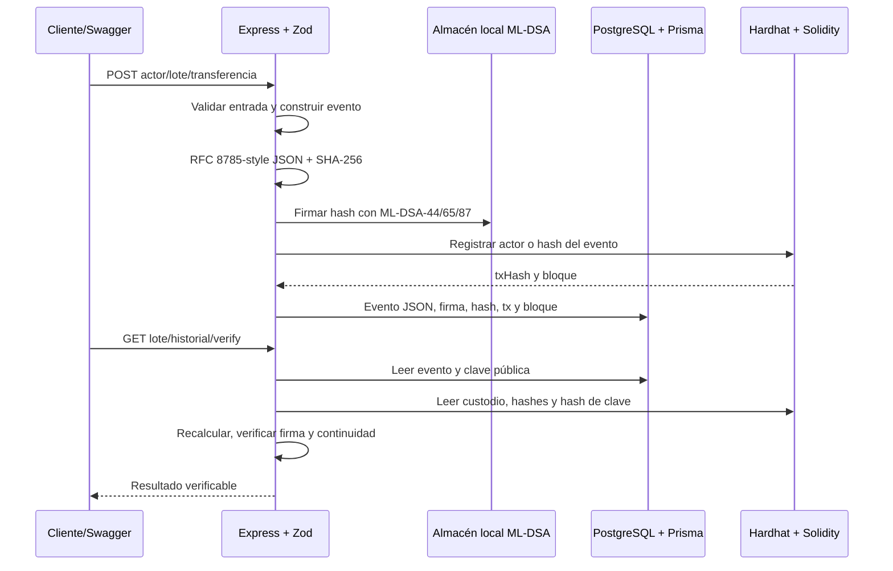

# Arquitectura

## Decisiones

- En cadena solo quedan `Actor` (dirección, rol, hash de clave pública), `Lot` (id hasheado, hash de metadatos, custodio) y hashes de eventos. Esto limita el costo y evita poner firmas grandes o metadatos en el EVM.
- En PostgreSQL queda el evento completo, su JSON canónico, firma ML-DSA, nivel, hash de transacción y bloque.
- El identificador de lote se convierte a `bytes32` con Keccak-256 para la llamada al contrato. El hash del evento y de metadatos es SHA-256 del JSON canónico; ambos caben en `bytes32`.
- `verifier` puede consultar y verificar, pero el contrato no le permite recibir custodia.
- El backend usa Prisma 7 con `prisma.config.ts` y `@prisma/adapter-pg`, porque es la API requerida por la versión fijada.
- El backend necesita una clave EVM local por actor para respetar el requisito de auto-registro y custodio actual. `CHAIN_PRIVATE_KEYS_JSON` permite mapear varias cuentas ficticias sin almacenar secretos en el repositorio.
